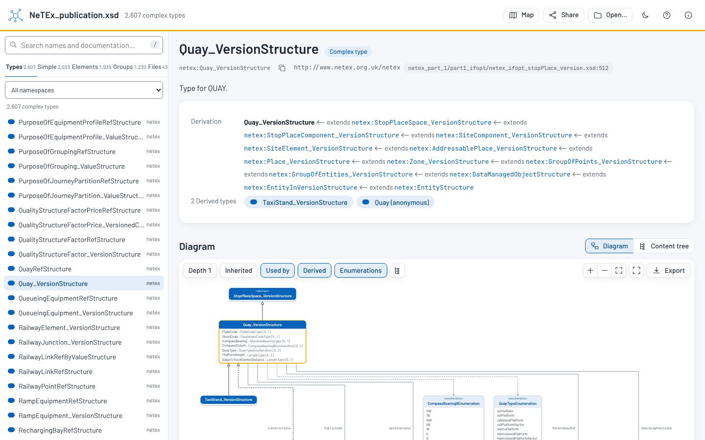
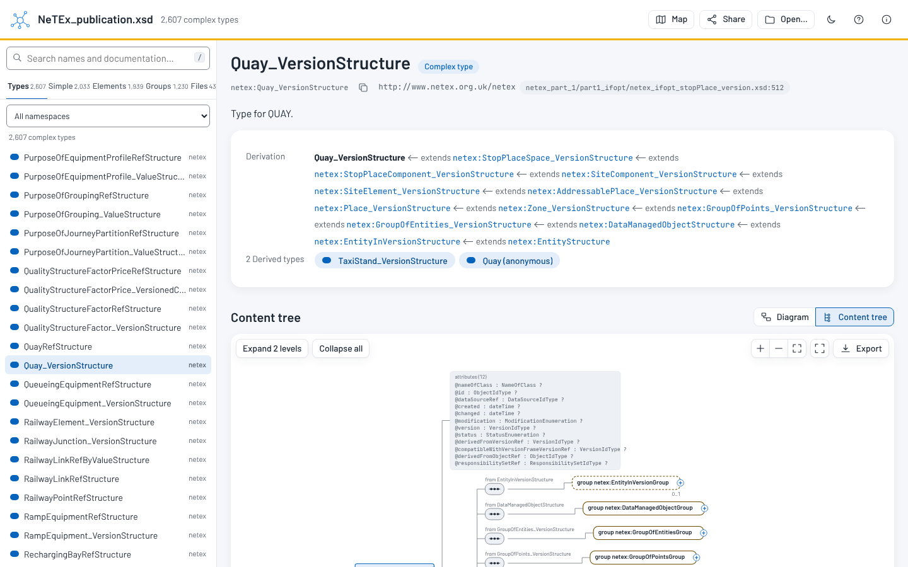
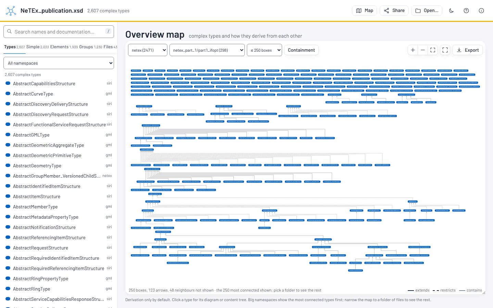

# schema-explorer

XML Schema (XSD) and JSON Schema (also inside OpenAPI and AsyncAPI) as
UML-like diagrams, readable type pages and version diffs.

Large schema sets such as NeTEx, railML or an OpenAPI specification are hard
to read as hundreds of `.xsd`, `.json` or `.yaml` files. schema-explorer
reads a whole set, follows its imports, includes and `$ref`s, and shows it the way people are used to: class diagrams, content
trees, and one page per type and element with every child, attribute,
cardinality and allowed value. It also compares two versions of a set and
says what changed and what breaks. It is the schema counterpart of
[ontology-explorer](https://github.com/Matdata-eu/ontology-explorer).

It runs entirely in the browser, so it can be published on GitHub Pages, and
a small command-line tool pre-indexes large sets, serves the viewer locally
and writes diff reports.

**Try it:** <https://matdata-eu.github.io/schema-explorer/> with NeTEx,
ERA TAF and TAP TSI, OASIS UBL 2.4, the W3C schema for schemas, the UIC OSDM
OpenAPI specification and the JSON Schema 2020-12 meta-schemas, or drop your
own files on it.



## Features

- **XML Schema** 1.0 (tolerating 1.1 constructs) and **JSON Schema**
  draft-04, -06, -07, 2019-09 and 2020-12 (picked by `$schema`), in JSON or
  YAML, including the schemas of **OpenAPI** 3.0/3.1 (`components.schemas`)
  and **AsyncAPI** 2/3 documents (schemas and message payloads). JSON Schema
  maps onto the same model and is shown in JSON terms: named schemas
  (`$defs`, `definitions`, components) are object or scalar definitions,
  properties have a cardinality from `required` and `minItems`/`maxItems`,
  a `$ref` in `allOf` is a generalisation, `oneOf`/`anyOf` are choices,
  `enum`/`const` are enumerations, `format`, `pattern`, `minimum` and the
  other validation keywords are facets, and `patternProperties` and
  `additionalProperties` are listed. `$ref` is resolved across files, JSON
  pointers, `$id` and `$anchor`.
- **Open** `.xsd`, `.json`, `.yaml` files or whole folders by drag and drop or the file picker:
  they are indexed in the browser (WebAssembly, in a worker), nothing is
  uploaded. Or open a pre-built bundle by its address (`?bundle=<url>`), or
  pick an example.
- **Sidebar**: complex types, simple types, global elements, groups and
  attribute groups, and files, per namespace; search over names,
  documentation and enumeration values. Lists are virtualised, so NeTEx's
  2,600 complex types scroll smoothly.
- **Type pages**: documentation, the derivation chain and derived types, the
  effective content model (child elements with cardinality and type,
  `sequence` / `choice` / `all` and groups, inherited rows grouped per base
  type and foldable), attributes (type, use, default or fixed), facets and
  enumerations with their documentation, identity constraints, where used,
  the source file and line, and the XSD of the component with linked names
  (for JSON Schema: the component's schema as JSON, with `$ref`s linked,
  its examples and deprecated/read-only flags).
- **Element pages** (global and local): type, substitution group head and
  members, nillable, abstract, default or fixed, where used.
- **Simple type pages**: restriction facets, enumeration table, list item and
  union member types.
- **Class diagrams** (laid out with ELK, drawn as SVG): a type with its
  attributes and simple-typed children, generalisation arrows for extension
  and restriction, composition arrows with multiplicities for complex-typed
  child elements, «enumeration» boxes, the types and elements that use it.
  Double-click to add neighbours; depth, direction, full screen, export to
  SVG, PNG, PlantUML and Mermaid.
- **Content-model trees** in the style of XML editors, expanded on demand.
- **Overview map** of the complex types of a namespace or a folder of files.
- **Version comparison**: load two versions of a schema set and see every
  added, removed and changed type, element, attribute, cardinality and
  enumeration value, rated breaking or not, with likely renames and
  namespace changes detected; changes are highlighted in the diagrams and
  trees, and exported as Markdown, HTML or JSON.
- **Share links** that restore the page, the diagram's options, added boxes,
  open tree nodes and zoom; light and dark themes; a short manual (Help).





## Running it locally

```sh
schema-explorer serve path/to/schemas/            # every .xsd file in the folder
schema-explorer serve openapi.yaml                 # JSON Schema, OpenAPI, AsyncAPI
schema-explorer serve main.xsd --bind 0.0.0.0:8080 --no-open
```

`serve` indexes the files once, opens the embedded viewer on them and serves
their source for the XSD view. Without files, the viewer opens empty and
indexes what you drop on it.

Binaries for Linux, macOS and Windows, `cargo install schema-explorer`, the
Docker image `ghcr.io/matdata-eu/schema-explorer` and the `<schema-explorer>`
web component on npm (`@matdata/schema-explorer`) come with the first tagged
release. Until then, build from source with `cargo build --release -p schema-explorer`.

## Indexing a schema set

The core reads an XSD set (XSD 1.0, tolerating 1.1 constructs) or a JSON
Schema set (JSON Schema, OpenAPI or AsyncAPI files) into one JSON bundle for the viewer: every global and local component keyed by qualified
name and source file and line, with documentation, references resolved to
ids, "where used" back-references, derived types, substitution group
members, effective content models and a search index.

```sh
schema-explorer index path/to/NeTEx_publication.xsd -o bundle.json
schema-explorer index schemas/ --compact -o bundle.json   # directories are read recursively
schema-explorer index OSDM-online-api.yml -o bundle.json  # OpenAPI with its schema files
```

A directory gives its `.xsd` files, or every `.json`, `.yaml` and `.yml`
file when it has no `.xsd` file. JSON Schema bundles say
`"language": "jsonSchema"` and carry a `json` block per component (its JSON
kind, JSON pointer, title, examples, flags); `$ref`s to other files are
followed from disk, and a `$ref` that cannot be resolved becomes an
`unresolved-ref` diagnostic.

Imports and includes are followed from disk; a location that cannot be
found falls back to an input file with the imported namespace or the same
file name, and otherwise becomes an `unresolved-import` diagnostic in the
bundle. The bundle format is versioned (`format`, see
`crates/core/src/bundle.rs`); `--compact` leaves out the parts the viewer
can recompute. In the browser, the WebAssembly build exposes
`index(names, contents, compact)` with the same output.

## Comparing versions

`diff` compares two versions of a schema set: global complex and simple
types, elements, attributes, groups and attribute groups added, removed or
changed, down to child elements (added, removed, retyped, cardinality,
order, compositor structure), attributes (use, type, default, fixed),
enumeration values, facets, base types, substitution groups and
documentation. Each change is classified as breaking (documents valid
against the old version may not be valid against the new one),
non-breaking or documentation only; removed and added components with
near-identical content are reported as possibly renamed. Components are
matched by qualified name and, when the target namespace changed between
versions (railML 3.2 → 3.3), by kind and local name (`--strict-namespaces`
turns that off).

```sh
schema-explorer diff railml-3.2/schema/ railml-3.3/schema/ --format md -o CHANGES.md
schema-explorer diff old.json new.json -o diff.json           # bundles work too
schema-explorer diff a.xsd,b.xsd c.xsd,d.xsd --format html -o diff.html --fail-on-breaking
schema-explorer diff api-v1.yaml api-v2.yaml --format md   # JSON Schema / OpenAPI
```

For JSON Schema, a property that becomes required, a removed property or
enum value, a new `additionalProperties: false`, a tighter `maximum` or
`maxItems`, or a dropped `nullable` are breaking; property order is not
compared.

Several paths for one side are joined with commas. The JSON diff format is
versioned (`format`, see `crates/core/src/diff.rs`). In the viewer, "Compare
two versions" on the open page takes two schema sets; a link
`?bundle=<new>&compare=<old>` opens the comparison directly. The overview
lists the changes with filters, each changed component gets a page with
both versions side by side, and diagrams and content trees of the later
version mark what was added (+, green), removed (−, red, struck through)
and changed (~, amber).

## Layout

- `crates/core`: Rust library that reads schema sets into an indexed model
- `crates/cli`: the `schema-explorer` command-line tool, with the viewer embedded
- `crates/wasm`: the core compiled to WebAssembly for the browser
- `web/`: the TypeScript/Vite viewer

## Publishing a schema set

`scripts/build-examples.sh <cli> <dist>` shows how the website is built: it
pre-indexes a schema set into `bundle.json` and puts its `.xsd` files next
to it (for the source view). Any static host works:
`index.html?bundle=examples/netex/bundle.json&sources=examples/netex/xsd/`
(JSON Schema examples keep their files under `schema/`).
Only publish schemas whose licence allows it.

The website's examples are fetched from their publishers at build time and
keep their own terms: NeTEx (GPL-3.0, NeTEx-CEN); TAF TSI and TAP TSI B.10
schemas, source: European Union Agency for Railways (reproduction authorised,
source acknowledged); UBL 2.4, copyright © OASIS Open 2024 (OASIS IPR
Policy); XMLSchema.xsd and xml.xsd, copyright © W3C (W3C Document License);
OSDM, UIC (Apache-2.0); JSON Schema 2020-12 meta-schemas, copyright © 2022
JSON Schema Specification Authors (BSD-3-Clause).
See [THIRD_PARTY_NOTICES.md](THIRD_PARTY_NOTICES.md).

## Development

```sh
cargo test
rustup target add wasm32-unknown-unknown
cargo install wasm-bindgen-cli --version <version of wasm-bindgen in Cargo.lock>
cd web && npm ci && npm run build
```

### Test fixtures

Tests on real-world schemas read them from the directory in `SCHEMA_FIXTURES`
(default `tests/fixtures`, gitignored) and are skipped when absent.
`scripts/fetch-fixtures.sh` fetches the public [NeTEx](https://github.com/NeTEx-CEN/NeTEx)
and [OSDM](https://github.com/UnionInternationalCheminsdeFer/OSDM) (OpenAPI)
schemas there; the tests also look for `railml/<version>/{schema,codelists}`
and `telematics/{netex,taf,taf-v3.5.1,b5,b10}`. For timings, run
`cargo test --release --test fixtures -- --nocapture`. Schemas whose licence forbids redistribution (such as railML)
must never be committed.

## Licence

[Apache License 2.0](LICENSE). © 2026 Mathias Vanden Auweele ([MatData](https://matdata.eu/)).
See [THIRD_PARTY_NOTICES.md](THIRD_PARTY_NOTICES.md) for included third-party software.
